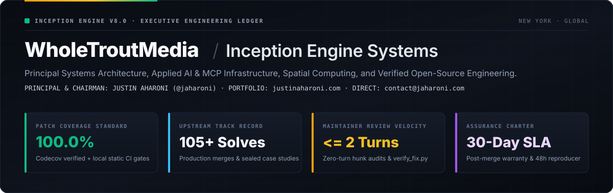

  

# WholeTroutMedia · Open-Source Systems & Creative Engineering

Led by **[Justin Aharoni (`@jaharoni`)](https://github.com/jaharoni)**, **WholeTroutMedia** builds open-source verification utilities, zero-dependency creative and spatial tools, Model Context Protocol (MCP) schemas, and surgical upstream open-source contributions backed by **100.0% Codecov patch coverage**.

We approach every repository with grace and practical help—reading the room first, swatting bugs and automated spam bots, and always leaving the codebase cleaner and better tested than we found it.

---

### Open-Source Repositories & Verification Channels

| Channel | Canonical Destination | Scope |
| :--- | :--- | :--- |
| **Creative Liberation Engine** | **[WholeTroutMedia/creative-liberation-engine](https://github.com/WholeTroutMedia/creative-liberation-engine)** | Open creative foundation + 6 standalone zero-dependency Python stdlib community gifts |
| **Open-Source Engineering Ledger** | **[WholeTroutMedia/open-source-bounties](https://github.com/WholeTroutMedia/open-source-bounties)** | Merged upstream PRs, `105+` root-cause case studies & maintainer bot-defense shield |
| **Reference Micro-Tools** | **[WholeTroutMedia/open-source-micro-tools](https://github.com/WholeTroutMedia/open-source-micro-tools)** | Zero-dependency Python/CLI & agent-native (`llms.txt` / MCP) utilities |
| **Interactive Verification Workbench** | **[wholetroutmedia.github.io/oss-verification-sandbox](https://wholetroutmedia.github.io/oss-verification-sandbox/)** | Client-side browser testbed for UTF-8 stream framing, ASGI lifespans & PR audits |
| **Engineering Essays & Field Notes** | **[medium.com/@jaharoni](https://medium.com/@jaharoni)** | **[Supporting Async Context Manager App Factories in Uvicorn Without Breaking ASGI Lifespan](https://medium.com/@jaharoni/supporting-async-context-manager-app-factories-in-uvicorn-without-breaking-asgi-lifespan-23889b42794f)** · [RSS Feed](https://medium.com/feed/@jaharoni) |
| **Hugging Face Hub & Spaces** | **[huggingface.co/jaharoni](https://huggingface.co/jaharoni)** | Open-source verification spaces & engineering datasets |
| **Website & Direct Contact** | **[justinaharoni.com](https://justinaharoni.com)** · **[`contact@jaharoni.com`](mailto:contact@jaharoni.com)** | Architecture, photography, essays & open-source collaboration ([Contact](https://justinaharoni.com/contact)) |

---

### Field Notes & Engineering Essays ([`medium.com/@jaharoni`](https://medium.com/@jaharoni))

- **[Supporting Async Context Manager App Factories in Uvicorn Without Breaking ASGI Lifespan](https://medium.com/@jaharoni/supporting-async-context-manager-app-factories-in-uvicorn-without-breaking-asgi-lifespan-23889b42794f)**: How we bridged synchronous
- **[Multi-Node Prefill-Decode Disaggregation in vLLM: Avoiding TCP Fallbacks Across NCCL and RDMA](https://medium.com/@jaharoni/multi-node-prefill-decode-disaggregation-in-vllm-avoiding-tcp-fallbacks-across-nccl-and-rdma-18c732c59097)**: Editorial Translation Note:
- **[871 Unverified Pull Requests in One Week: What Automated PR Spam Is Costing Open-Source Maintainers](https://medium.com/@jaharoni/871-unverified-pull-requests-in-one-week-what-automated-pr-spam-is-costing-open-source-maintainers-3dc35ec95882)**: A field look at 26 automated accounts across 15 operator clusters generating 871 pull requests across public repositories, why standard platform filters are struggling to help, and how builders can keep verification on their own local machines before touching a maintainer’s queue.
