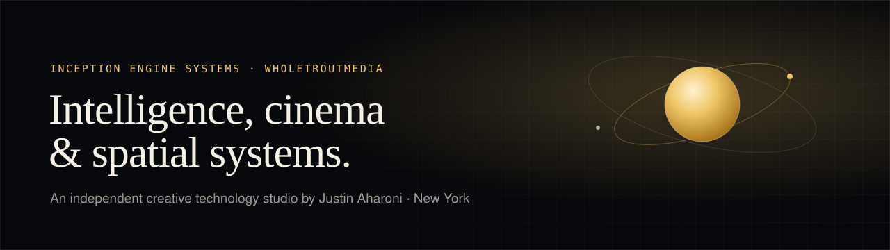

<picture>
  <source media="(prefers-color-scheme: dark)" srcset="https://raw.githubusercontent.com/WholeTroutMedia/.github/main/assets/profile-banner-dark.svg" />
  <source media="(prefers-color-scheme: light)" srcset="https://raw.githubusercontent.com/WholeTroutMedia/.github/main/assets/profile-banner-light.svg" />
  
</picture>

**WholeTroutMedia is the open-source home of [Inception Engine Systems](https://inceptionengine.systems)**, an independent creative technology studio led by [Justin Aharoni](https://github.com/jaharoni). We build tools for AI, media and spatial work, and we share the building blocks openly.

**[→ Request early access to Inception Engine](https://inceptionengine.systems)** &nbsp;·&nbsp; [contact@jaharoni.com](mailto:contact@jaharoni.com)

---

### What we build

| | |
| :--- | :--- |
| 🔮 **[The Oracle](https://oracle.inceptionengine.systems)** | An MCP server that gives Claude and other AI assistants **69 ready-to-run skills** across video, voice, 3D, research, data and hardware, plus starter kits tuned to the machine you already have. |
| 🎨 **[Creative Liberation Engine](https://github.com/WholeTroutMedia/creative-liberation-engine)** <br><sub>MIT licence</sub> | An open creative foundation that adapts to the person using it, so you can go from first sketch to finished media without fighting your tools. |
| 🧰 **[Open-source micro-tools](https://github.com/WholeTroutMedia/open-source-micro-tools)** | Small, zero-dependency Python tools you can drop into any project, such as a cryptographic media notary and EXIF privacy scrubber, a PBR material synthesizer and an FCPXML audio-ducking compiler. |
| 🧪 **[Verification sandbox](https://wholetroutmedia.github.io/oss-verification-sandbox/)** | A workbench that runs in your browser for checking UTF-8 stream framing, ASGI lifespans and pull-request readiness. Nothing to install. |
| 🤝 **[Open-source contributions](https://github.com/WholeTroutMedia/open-source-bounties)** | Our public record of upstream fixes, bug reproducers and tools that help maintainers keep spam bots out. |

---

### Try The Oracle in one command

```bash
claude mcp add --transport http the-oracle https://oracle.inceptionengine.systems/mcp \
  --header "Authorization: Bearer YOUR_KEY"
```

Works with Claude Code and any MCP-compatible client. **[How to connect →](https://oracle.inceptionengine.systems/#connect)**

---

### Work with us

- **Studios and companies:** need a custom integration, pipeline or AI workflow? **[Start an enterprise or custom-build request](https://github.com/WholeTroutMedia/.github/issues/new?template=03_enterprise_contract_sprint.yml)** or email [contact@jaharoni.com](mailto:contact@jaharoni.com).
- **Developers:** stuck integrating one of our tools? **[Ask for implementation help](https://github.com/WholeTroutMedia/.github/issues/new?template=01_implementation_help.yml)**.
- **Ideas:** want a new feature, adapter or kit? **[Suggest it here](https://github.com/WholeTroutMedia/.github/issues/new?template=02_feature_request.yml)**.

---

<sub>Inception Engine Systems · WholeTroutMedia · New York &nbsp;·&nbsp; [inceptionengine.systems](https://inceptionengine.systems) · [justinaharoni.com](https://justinaharoni.com) · [Hugging Face](https://huggingface.co/jaharoni) · [@jaharoni](https://github.com/jaharoni)</sub>
