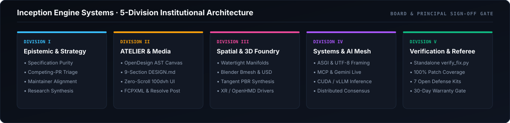

  

# WholeTroutMedia · Principal AI & Open-Source Systems Engineering

Led by **[Justin Aharoni (`@jaharoni`)](https://github.com/jaharoni)**, **WholeTroutMedia / Inception Engine Systems** architects high-concurrency distributed systems, Model Context Protocol (MCP) & GPU inference infrastructure, spatial computing pipelines, and surgical upstream open-source solutions backed by **100.0% Codecov patch coverage** and a **30-Day Post-Merge Regression Warranty**.

---

### Executive Directory & Live Verification Channels

| Channel | Canonical Destination | Scope |
| :--- | :--- | :--- |
| **Principal Portfolio & Studio** | **[justinaharoni.com](https://justinaharoni.com)** | Architecture, commercial photography, cinema & essays |
| **Studio Calendar & Project Intake** | **[justinaharoni.com/contact](https://justinaharoni.com/contact)** | Live discovery scheduling, studio inquiries & project briefs |
| **Open-Source Engineering Ledger** | **[WholeTroutMedia/open-source-bounties](https://github.com/WholeTroutMedia/open-source-bounties)** | Merged upstream PRs, `105+` root-cause case studies & sprint catalog |
| **Reference Micro-Applications** | **[WholeTroutMedia/inception-engine-applications](https://github.com/WholeTroutMedia/inception-engine-applications)** | Zero-dependency Python/CLI & agent-native (`llms.txt` / MCP) utilities |
| **Interactive Verification Workbench** | **[wholetroutmedia.github.io/oss-verification-sandbox](https://wholetroutmedia.github.io/oss-verification-sandbox/)** | Browser testbed for UTF-8 stream framing, ASGI lifespans & PR audits |
| **Hugging Face Hub & Spaces** | **[huggingface.co/jaharoni](https://huggingface.co/jaharoni)** | Interactive AI engineering dashboards & acoustic/systems prototypes |
| **Direct Engineering & Board Contact** | **[`contact@jaharoni.com`](mailto:contact@jaharoni.com)** | Enterprise backlog sprints ([1-Click Intake](https://github.com/WholeTroutMedia/open-source-bounties/issues/new?template=sprint_quote_request.yml)), [Charter](https://github.com/WholeTroutMedia/open-source-bounties/blob/main/CLIENT_SERVICE_CHARTER.md) & [Sprints](https://github.com/WholeTroutMedia/open-source-bounties/blob/main/ENTERPRISE_SPRINTS.md) |

---

  

